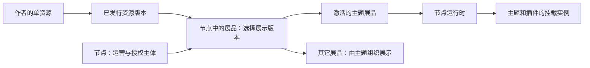
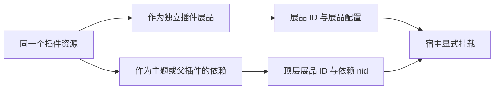
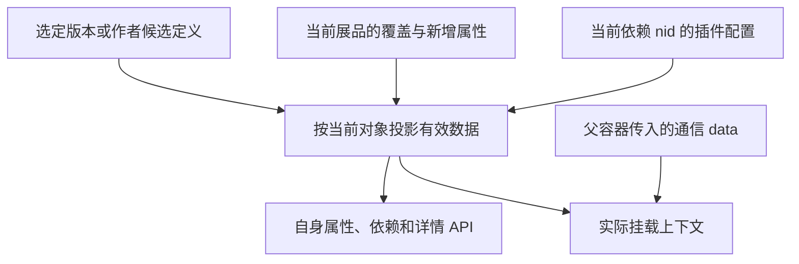
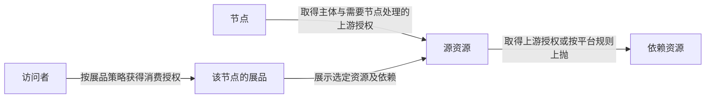

# 先看平台对象，再设计本地开发

状态：2026-10-14 复查稿。本文区分已确认业务、建议设计与待验证契约，不表示预览能力已经实现。

依据：[节点运营产品文档](https://freelog.yuque.com/fsl0oy/gkva0w/iyvnt75wcebadyyx)、平台帮助中心、当前 Console 和运行时实际代码。源码证据编号见 [02](./02-契约证据与验收场景.md)。产品材料中的 Pending、历史流程与当前代码分开认定。

范围：正式节点中的主题、插件本地开发。**不使用平台测试节点，也不接入测试节点规则。** 下文“本地插件预览宿主”只是临时挂载工具，不是另一种节点。

## 1. 四个核心对象

这张图描述单资源进入节点的路径；节点自建合集不要求先有一个作者资源版本。

| 对象 | 归属与职责 | 不要混成什么 |
|---|---|---|
| 资源 | 作者发行、授权的对象；主题/插件也是资源类型 | 节点里的展品或一次浏览器挂载 |
| 单资源版本 | 文件及该版本属性、配置定义、依赖声明 | 节点已经选用的展示版本 |
| 节点 | 节点商的运营载体、取得资源授权的主体 | 节点商个人账号 |
| 展品 | 某节点中的展示、配置和对外授权对象 | 原资源的另一份作者版本 |
| 主题展品 | 承担节点入口角色的主题类型展品 | 脱离展品模型的另一套主体 |
| 依赖节点 | 一个展品依赖树中的链路位置，以 nid 定位 | resourceId；同一资源可能沿多条链出现 |
| 挂载实例 | 浏览器中一次实际挂载，有容器、路由、生命周期 | 平台展品、依赖节点或持久化配置 |

已确认：主题通过创建展品并启用；Console 的 `presentableId` 与运行时的 `exhibitId` 属于两端展品标识语境。运行时检查 `nodeThemeId`，实际以 `themeInfo.exhibitId` 授权和挂载。**不拿资源 ID 代替主题展品 ID**。03 中两个 dev 样本已确认 nodeThemeId 等于返回 presentableId；不是对所有部署/服务端实现的完整证明（E6、E11、E19）。

一个节点可以有多个主题展品，但同一时刻只激活一个；其它展品是否出现在页面上，还取决于主题支持与实际加载行为，而非“添加成功就自动展示”。

## 2. 插件的两种角色

独立插件展品有自己的展品上下文。依赖插件位于宿主的依赖树，不要求给每个插件创建独立展品；主题依赖插件的配置保存在顶层展品与对应 nid 的范围内（E15）。

同一 nid 挂载两次，可以有两个前端实例，但平台配置仍然属于同一依赖节点。实例 A/B 的测试差异是预览场景，不证明平台支持分别持久化这两个实例的配置。

## 3. 运行时数据不是作者表单的原样复制

展品覆盖与依赖覆盖按对象分别应用，不是把主题的全部配置继续覆盖到每个子插件。

| 数据 | 来源与作用域 | 本地开发如何处理 |
|---|---|---|
| 系统解析属性、作者只读属性 | 选定资源版本 | 作者候选替代版本定义；模拟解析值明确标记，不当真实解析证明 |
| 可选配置定义 | 作者版本中的 key、输入方式、候选项、默认值 | 从候选稿读取，按类型能力与字段规则校验 |
| 展品可选值与新增属性 | 当前展品的 `presentableRewriteProperty` | 读取真实基线，或在本地模拟这一层；不写回线上 |
| 主题依赖插件可选值 | 当前主题展品中对应 nid 的 `dependencyRewriteProperty` | 按链路映射，不按标题或 resourceId 全局覆盖 |
| 有效属性 | 平台/开发提供器向应用返回的最终视图 | 保持 API 响应形状，注明每个值的来源 |
| 父子通信与临时参数 | 一次挂载的调用方 | 单独通道，不伪装成平台持久化配置 |

Console 已确认：展品可选值优先取自身覆盖，否则取定义默认值；新增属性与覆盖一起保存。依赖插件页面读取对应节点的有效属性，再展示可选项（E14、E15）。最终服务端合成细节尚未全部定位，不能自行猜出另一套平台优先级。

本地建议：模拟“版本定义”和“节点使用配置”两种编辑角色。作者改默认值不改节点选择；节点配置改值不改作者默认值。产品要求节点设置的依赖插件配置优先于主题代码配置，运行时接入前需验证这个规则如何落到实际 API 与挂载参数。

## 4. 换版本也是一个需要模拟的流程

作者发新版本、节点切换展示版本、依赖解析版本改变，是三个不同变化。

节点产品规则的要点：有效已选值保留；不合法下拉值回到新默认值；旧版本消失的定义不继续展示；版本属性与节点新增键冲突时按定义类型处理。自动更新还影响依赖版本，不能只换主文件。具体产品依据见[设置展示版本](https://freelog.yuque.com/fsl0oy/gkva0w/iyvnt75wcebadyyx#QmPvO)。

本地建议采用显式的“切换候选与配置迁移”动作：

不能用“配置都报错拒绝”代替平台正常换版的默认回退；也不能用“自动回退”掩盖直接输入的非法配置。正常编辑校验与版本迁移是不同动作。

依赖 nid 可能随树变化而改变。配置只能通过已确认的链路映射迁移；存在多个候选位置时报告歧义，不按资源标题猜测，也不把旧 nid 当永久身份。

## 5. 三层授权，不是一份个人合同

三层的合同主体不同，即使资源作者、节点商与访问者是同一个人，也不能因此合并。签约成功与已获得授权也不等价，待支付等情况仍需执行合同。是否免交互、可复用合同或需解决上抛，以真实平台规则为准，不要求每层都手动重新签一次（E12、E13）。

CLI 0.5.8 添加直接依赖只是声明关系；不负责签约、支付或处理上抛。预览不得扩大这个边界。

## 6. 合集、存储对象与本期范围

| 对象 | 上游来源/成员 | 与单资源不能混同的地方 |
|---|---|---|
| 作者资源合集 | 作者管理资源单品 | 作者的发行对象；不能称节点自建展品合集 |
| 签约资源合集形成的展品 | 引用资源合集及其单品 | 节点展示与消费授权上下文 |
| 节点自建展品合集 | 收录节点已有或新签成的普通展品 | 不必先建作者资源壳；单品不是本地文件 |
| 存储对象 | 存储空间中的文件与信息 | 不是已发行版本，不能直接当正式 CLI 依赖 |

Console 将普通、资源合集、节点自建合集展品分支处理；运行时有合集单品列表、详情、文件和依赖 API，访问作用域包含 exhibitId/itemId/nid（E16、E17）。各 API 的 subjectType、identityType、articleType 不能共享一套数字枚举猜含义。

本期只设计主题/插件单资源候选与本地依赖预览。它们可以读取节点真实普通展品和两类合集；开发场景也可使用明确的局部 fixture。**不承诺完整模拟合集管理、所有合集授权规则或存储平台**；未适配的调用明确报未支持，不能返回假空列表表示通过。

## 7. 可靠性边界

已确认的是上述对象、Console 保存入口与当前运行时读取路径。尚待验证的是最终响应投影、线上部署兼容和“未在正式树中的新市场依赖”的合法内容路径。

产品文档包含历史与 Pending 段落，帮助中心也有旧限制描述；不借此把所有文字都当作现行平台约束。本方案不改节点创建、删除、结算或策略语言产品设计。

完整 mock 在运行时接入前仍是设计；浏览器能打开本地代码、文档经复审，都不能替代后续实际 API、网络和纯线上发行验收。
