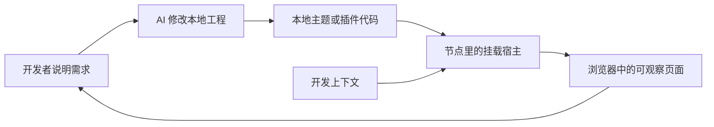
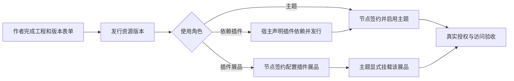
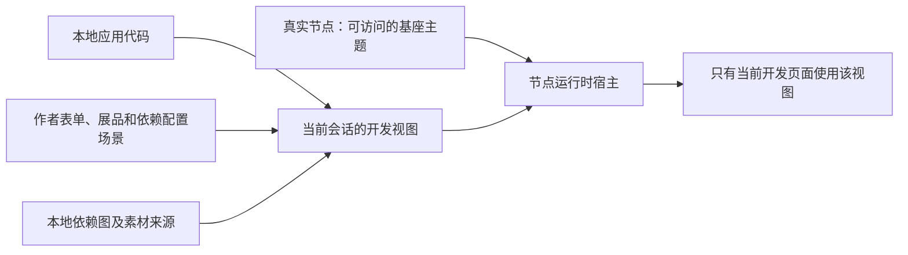
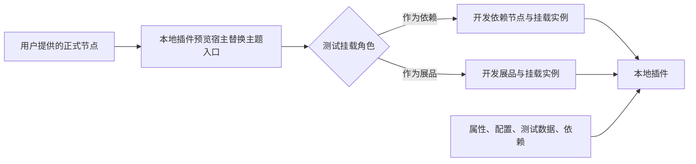
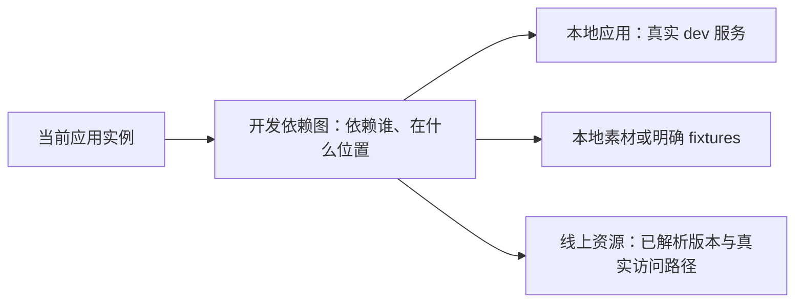
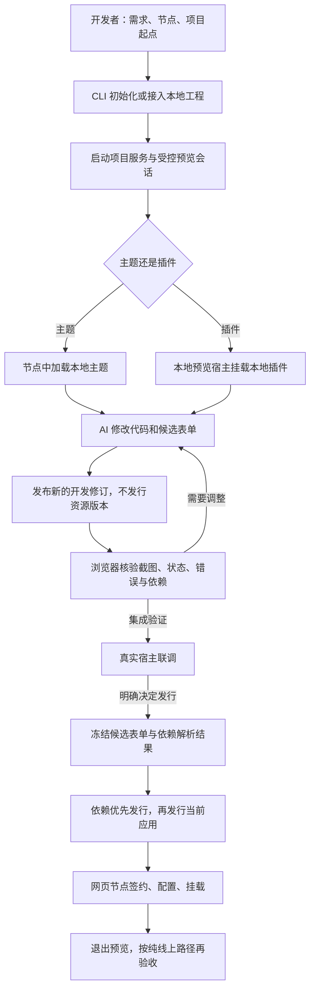

# 从最小模型到主题、插件开发闭环

状态：讨论稿，2026-10-14。“预览会话”“本地插件预览宿主”“开发数据提供器”是建议新增的能力，不是 0.5.8 已有功能。先读 [00 · 平台对象](./00-平台对象与数据边界.md)，再看本文流程；现有能力与源码证据见 [02](./02-契约证据与验收场景.md)。平台测试节点明确不纳入方案。

## 1. 最小模型：代码要被谁运行

三个东西缺一不可：代码入口解决“加载哪个项目”；宿主解决“谁把它挂载到哪”；开发上下文解决“它读到什么身份、属性、配置、依赖”。

**主题负责组织页面，插件被某个页面或父插件挂载。** 插件作为主题依赖，或作为节点展品被主题加载，是两条合法路径；资源类型与挂载角色不能混为一谈。

| 对象 | 是什么 | 不是什么 |
|---|---|---|
| 本地应用 | 主题/插件工程与本地服务地址 | 已发行资源版本 |
| 作者表单 | 自定义属性、可选配置定义、拟发行依赖 | 某次挂载选择的配置值 |
| 展品配置 | 节点侧针对当前展品的可选值与新增属性 | 作者默认值或浏览器实例参数 |
| 依赖插件配置 | 当前顶层展品中对应 nid 的配置 | 全局资源配置或另一份插件展品 |
| 挂载实例 | 某个父容器中的一次加载 | 资源本体；同一插件可以出现多次 |
| 开发上下文 | 当前实例的身份、有效属性/配置、依赖关系及内容来源 | 平台合同或线上依赖树 |
| 预览会话 | 一组受控的本地应用、实例和场景 | 新资源版本或公共节点设置 |

## 2. 开发视图与正式视图分开

正式流程仍然是：

“节点签约并有展品”也不意味着页面自动显示它；主题必须实际挂载。以上签约/启用由网页完成，本期 CLI 不自动操作节点或签约。

授权还分源资源对上游、节点对资源/上抛、访问者对展品三层，见 [00 §5](./00-平台对象与数据边界.md#5-三层授权不是一份个人合同)。既有合约能否复用以平台判断为准，不把“发行新版本”写成“所有人重新签约”。正式节点要选择相应展示版本，不能只完成作者发行就称已上线到该节点。

开发时采用另一条通道：读取节点的真实基础环境，在**当前已连接浏览器**中叠加本地开发视图，不修改节点公共配置，不创建新发行版本。

基座主题是进入运行时的载体，不是本地应用的真实资源身份。不能用它的主题 ID、合约或可选配置冒充新应用的事实。

## 3. 插件第一次怎么打开

### 3.1 主题项目：替换主题入口

已有可用基座主题时，开发者启动主题本地服务，在节点页面使用 `dev=<主题本地地址>`。这是已有入口，但当前仍读基座的线上数据；完整表单 mock 需要新增开发数据提供器。

### 3.2 插件项目：给它一个本地预览宿主

推荐新增一个轻量、临时的本地插件预览宿主，以本地主题形式提供挂载容器、基础参数输入和诊断信息，只负责运行被测插件。它不是平台测试节点。

它仍依托一个可进入运行时的真实节点基座：节点必须可访问且已有可用主题。节点无主题、被冻结或当前访问者无权进入时，预览宿主不能绕过这些门禁。

两种角色都通过正式运行时挂载机制执行生命周期、路由、隔离和父子通信。预览宿主不进入插件发行物，也不要求把被测插件先签成真实展品。

**这不是仅写一个测试页面就能完成的现成功能。** 当前挂载 API 能消费调用方提供的上下文，但实时查询还会访问平台；预览宿主与运行时的开发数据提供器必须配套，不能随便编造 ID 调平台接口。

### 3.3 进入真实宿主联调

单独调试通过后，把插件接到真正使用它的本地主题/父插件中。宿主要显式挂载它，不能由 CLI 静默改业务源码插入插件。

已有线上挂载可用现有 `dev=replace` 替换代码；它支持主题和多个插件入口同时替换，**但不会发起尚不存在的挂载，也不解决未发行依赖的数据上下文**。

本地预览宿主证明“插件能运行”；真实主题联调证明“宿主正确集成”；正式节点验收证明“发行和授权链正确”。三层不能互相替代。

## 4. mock 哪些信息，谁负责填写

### 4.1 作者定义、节点配置和挂载参数分别模拟

| 输入 | 来源与作用 | 发行时如何处理 |
|---|---|---|
| 文件分析元数据 | 开发时可有明确标记的模拟值 | 必须重新上传/解析，模拟结果不能当解析证明 |
| 自定义属性、系统附加输入 | 作者候选表单 | 按正式字段规则校验并提交；附加输入仍须匹配实际解析 |
| 可选配置定义 | 作者定义 key、方式、候选值、默认值 | 随资源版本发行 |
| 展品配置值与新增属性 | 真实展品基线或本地模拟展品覆盖 | 不发行到资源默认值；真实节点另行设置 |
| 依赖插件配置值 | 当前顶层展品的对应 nid；本地可模拟此层 | 不生成插件展品，不把 nid 当永久资源身份 |
| 挂载参数与父子通信数据 | 预览宿主或真实宿主的某次调用 | 不冒充节点持久化配置；能力与真实宿主需匹配 |

有效值按当前展示对象计算：选择版本/候选定义，再应用这个展品或这个依赖节点的合法配置。无覆盖取定义默认值；展品新增属性单独合入，并处理与候选定义的键冲突。父子通信 data 不参与这套优先级。候选表单是完整视图，删除的版本字段不从旧基线偷偷补回；真实节点新增的键则按自己的来源保留或迁移。

直接编辑时，下拉值必须属于候选集合。切换候选/版本时另走迁移：合法已选值保留，失效选择按产品规则回默认并显示原因，消失的定义不再展示。删键、改控件类型、同名节点属性冲突都有诊断，见 [00 §4](./00-平台对象与数据边界.md#4-换版本也是一个需要模拟的流程)。mock 不允许非法输入绕过正式校验。

同一 nid 的两次挂载默认共享节点配置；要演练不同实例参数，使用明确的挂载场景/受支持的调用参数，不能假称平台已经提供按前端实例持久化可选值的能力。

### 4.2 CLI 不必先支持全新的资源状态机

推荐第一阶段复用现有能力：需要完整作者表单时，为应用**建壳一次**，使用已有 `N.version.json` 编辑属性、配置和远端依赖。建壳不是发行版本，也不要求节点签约这个尚未发行的应用。

现有 `create` 仍要求本地产物锚点存在；`init theme/widget` 默认已创建空 `dist`，所以建壳不必先构建。接入其它工程时，若锚点不存在，需先准备对应目录/文件。正式发行前才要求完整可上传产物；修改代码、普通自定义属性和配置定义不应强制每次重新构建。系统附加属性另有解析前置，不承诺仅建壳就能用正式命令编辑全部分析字段。

仅 `init`、尚未建壳时，先允许代码与显式 fixtures 预览；不能假称现有 `version attr/option/dep` 已能为未绑定身份保存工作稿。完全离线的作者表单编辑可以后续设计，不先改现有身份/版本稿契约。

建议新增的开发描述只记录节点、组件绑定、展示基线引用、本地模拟的展品/nid 配置、挂载场景和本地依赖，不复制正式作者表单。读取的线上配置是注明版本与来源的基线，不是第二份作者编辑稿。`N.json` 不加 token、mock 合同或版本历史；发布成功删稿后，重新编辑需从已发布版本建立新稿，开发描述不充当旧版本备份。

### 4.3 基座、展示版本和候选的绑定要明确

新主题/插件没有自己的展品时，建立预览命名空间内的展示对象，配置从明确场景开始，不自动继承空白基座主题的配置。已有应用升级时，绑定真实展品及其展示版本，读取这份配置基线；作者稿的来源版本与节点展示版本不同必须报告，不能无提示拼接。

“跟随线上”场景按真实节点的展示/自动更新状态读取；“候选联调”场景固定作者候选和解析版本。两者之间显式切换、展示差异；预览固定版本不是平台永远锁版本的业务规则。

依赖图改动可能改变 nid；用确认过的链路关系重新定位配置。歧义映射阻止生效，不按标题匹配，不把旧 nid 值移给另一个插件。最终自身查询、展品详情/列表与实际挂载必须一致；局部 fixture 之外的真实对象继续走真实 API，未适配类型明确报未支持。

### 4.4 依赖分成“关系”与“内容来源”

- 本地未发行插件：用本地组件引用建立开发关系，不填进正式 `dependencies` 伪装成已发行目标。
- 线上依赖：正式声明复用现有 CLI 校验，预览记录实际解析到的版本；刷新可解析版本必须显式报告变化。
- 同一资源经不同父链出现时，是不同依赖节点；同一插件挂载两次时，是不同实例。不能仅按 resourceId、标题或渲染名称全局覆盖。
- 插件的依赖也要解析；只给主题补一层数据不能算完整。移除关系后，相应挂载和缓存失效，不能继续消费旧节点。

## 5. 真实素材与模拟素材不能混淆

**mock 本地声明，不 mock 商业授权来取得真实内容。** CLI 作者登录与浏览器访问者登录也不是同一身份。

| 目标 | 合理路径 | 验收结论 |
|---|---|---|
| 先实现图片/视频/广告区域的交互 | 用本地素材或清楚标记的测试响应 | 交互通过，不代表市场资源可用 |
| 调试已有合法节点依赖/展品 | 使用其真实展品、依赖链路与正常授权 | 只证明这条实际访问链路 |
| 新加市场资源，但尚不在节点依赖图中 | 平台需要提供开发上下文下的访问契约，或先建立真实可访问链路 | 不能只靠本地 JSON 或个人已签约解决 |
| 需要验证无授权、待支付等界面 | 对 fixture 场景模拟错误/状态 | 不创建真实合同、支付或授权事件 |

建议平台另行提供“开发访问上下文”：核验开发者、真实开发主体、目标版本与实际有效授权，为本地候选关系提供受限访问。它不把预览图保存成已发行版本，也不把开发权限授予节点公众。

这是**待平台定稿/实现的能力**，不是已存在的 API。具体使用何种有效身份与合约必须由平台确认；不能擅自恢复 `batchAuth` 个人判断，不能借基座主题的合同授权另一资源。当前没有这项契约时，新市场依赖真实消费明确阻塞，但本地 fixture 开发可以继续。

## 6. 开发者与 AI 的完整旅程

AI 可以启动服务、打开工具自带浏览器、修改项目和查诊断；不能为了让页面变绿而自动发行、上架、改节点、签约或付款。浏览器登录、证书信任和本地网络权限需用户完成。

本地代码 HMR 与元数据更新是两类变化：代码交给构建工具；属性/配置/依赖形成原子修订，运行时替换同一快照并按需要重新挂载。全部自身查询必须读取同一生效修订，不允许“同步 getter 看 mock、异步 getter 又读回线上旧值”。

元数据失败保持上一份已确认的视图，并明确显示新修订未生效；不要用旧画面表示新测试通过。依赖环、服务断开、配置失效、协议不兼容都必须可定位到具体组件/实例。

### 例子：AI 开发一个小游戏插件

1. 开发者给出节点和需求。AI 初始化插件、启动本地服务；本地预览宿主在该正式节点里主动挂载它，不要求先发行插件。
2. 先使用本地图片和广告完成/失败 fixtures 做出交互。页面明确标记模拟素材和模拟结果，不触发真实广告奖励。
3. 需要完整作者表单时，准备产物锚点并建壳一次。AI 编辑插件的自定义属性与配置定义；开发者模拟节点对该插件的难度选择，两种编辑各自保存。挂载通信参数另行配置。
4. 新增本地计分插件：加入开发依赖图，由小游戏主动挂载。修改计分插件自己的属性与依赖时，只改变对应组件及其受影响实例。
5. 想试市场图片或插件：加入真实资源候选关系，检查内容访问路径。缺少平台开发访问能力时明确阻塞真实素材测试，仍可继续用 fixture，不伪装为市场资源已授权。
6. 接到真正的本地游戏主题，验证页面布局、父子通信和多个插件实例。本地预览宿主阶段的通过不能代替这一步。
7. 决定上线后，先发行尚未发行的计分插件，再把真实引用写入小游戏；逐项发行、上架和读回，最后接入真实主题或插件展品。
8. 网页完成所需节点签约与配置，打开没有开发参数的页面再验收。只有这一步能证明纯线上闭环。

## 7. 从预览到真实发行

1. 固定这次候选表单、实际产物、远端解析版本和本地依赖图，先停止把后续编辑混入本次发行。
2. 检查本地依赖的发行前置。没有已发行版本或未满足当前 CLI 可引用状态的目标，先发行其单资源；当前 CLI 添加目标要求上架，不因预览放宽。
3. 本地依赖拓扑有环则停止。按叶子到宿主逐个发行；这是明确的发行计划，不新增“批量自动发行”功能。
4. 真实 ID、版本、范围经读回确认后，通过正式依赖能力写入宿主稿。模拟的展品/nid 配置、实例参数、虚拟 ID、mock 结果和预览宿主都不得进入版本 payload。
5. 正常上传解析、字段校验、提交、策略/上架等原有流程不绕过。预览成功不替代这些步骤。
6. 在网页完成所需节点签约、展示版本选择和配置；已有合同是否复用以平台为准。依赖插件配置落在对应顶层展品/nid，独立插件配置落在自身展品；访问者授权另行核验，不能把本地模拟直接写成真实授权。
7. 关闭开发提供器、移除所有预览/入口替换参数，在新的普通页面核验线上结果。退出预览不得自动修改节点或撤销合同。

这才闭环：**开发期间不发行；准备上线时显式发行；上线后不依靠 mock 通过验收。**
