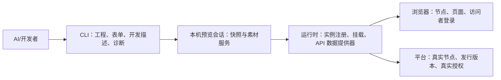
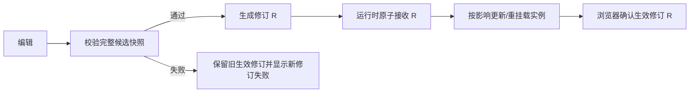

# 当前证据、协同契约与验收场景

状态：讨论稿，2026-10-14。当前能力与目标改造分开；已做 03 的真实初始化、只读 dev 取样与节点门禁观察，未进行完整 mock 联调。测试表仍是验收计划，不是 PASS 报告。

已阅读平台帮助中心与[节点产品文档](https://freelog.yuque.com/fsl0oy/gkva0w/iyvnt75wcebadyyx)，并核对 Console 实际调用。按用户要求，测试节点和测试规则不纳入方案；本地预览宿主不属于平台测试节点。

## 1. 当前能力的证据

外部仓库按同级目录读取：运行时 `freelog-runtime` 提交 `2fa5f83f`，Console 所在 `freelogfe-web-repos` 提交 `c2c135d0b`，两者核对时工作树干净。下面源码行号以本次检查为准，不表示线上部署一致。

| 编号 | 直接证据 | 已确认的边界 |
|---|---|---|
| E1 | [dev.ts](../../../freelog-runtime/packages/freelog-runtime-core/src/structure/dev.ts)，5–36 行 | `dev=replace` 与 `dev=<入口>` 是不同模式；`auth` 参数优先，不把 dev 当平台环境选择 |
| E2 | [widget.ts](../../../freelog-runtime/packages/freelog-runtime-core/src/structure/widget.ts)，99–161、180–242 行 | URL 或 `widget_entry` 可以改变加载入口；不创建挂载，不补身份/关系；展品缺依赖树才查询详情，根节点不能为空 |
| E3 | [handler.ts](../../../freelog-runtime/packages/freelog-runtime-api/src/services/handler.ts)，69–93 行 | 文件流 `returnUrl:true` 只构造 URL；不能据此声称挂载必定先请求授权，也不能证明真实文件可访问 |
| E4 | [widgetUtils.ts](../../../freelog-runtime/packages/freelog-runtime-core/src/structure/widgetUtils.ts)，61–126 行 | `ForTheme` getter 读挂载缓存；`getSelfDep/getSelfProperty` 使用平台查询，不自动 mock |
| E5 | [widget.ts](../../../freelog-runtime/packages/freelog-runtime-core/src/structure/widget.ts)，209–223、278–287、344–355 行 | 插件实例名与顶层/资源身份、seq 相关；注入的 `renderWidgetOptions.data` 不等于自身属性或依赖查询被接管 |
| E6 | [pc-ui/App.tsx](../../../freelog-runtime/packages/pc-ui/src/App.tsx)，93–102、153–180、207–252 行 | 节点、登录、主题存在及授权检查先于挂载；本地主题 iframe 判断仍用线上主题的 bundleTool |
| E7 | [freelogLibrary/index.ts](../../../freelog-runtime/packages/freelog-runtime-core/src/freelogLibrary/index.ts)，19–70 行 | 前端库通过自身依赖查找并读取 meta/文件；不是插件入口替换可以覆盖的全部依赖类型 |
| E8 | [CLI draft.ts](../../packages/cli/src/local/draft.ts)，14–38、55–85 行；[types.ts](../../packages/cli/src/local/types.ts) | 当前版本稿要求真实绑定身份；首版说明固定为空；不是未绑定开发元数据存储 |
| E9 | [CLI dep.ts](../../packages/cli/src/domain/version/form/dep.ts)；[属性](../../packages/cli/src/domain/version/form/attr.ts)；[配置](../../packages/cli/src/domain/version/form/option.ts) | 0.5.8 正式表单与依赖能力可复用；依赖目标须有可用发行版本，文件分析仍有独立门禁 |
| E10 | [模板生命周期](../../packages/templates/vite-react-ts/template/src/main.tsx)；[模板配置](../../packages/templates/vite-react-ts/template/vite.config.ts) | 当前模板有 mount/unmount、开发工具与本地服务配置，没有本次完整预览协议 |
| E11 | [主题创建](../../../freelogfe-web-repos/packages/console/src/pages/node/formal/$id/Themes/index.tsx)，111–145 行；[主题列表](../../../freelogfe-web-repos/packages/console/src/models/nodeManagerPage/themeEffects.ts)，83–138 行 | 主题使用展品创建/启用接口；不能以 resourceId 代替主题展品 ID |
| E12 | [节点合同查询](../../../freelogfe-web-repos/packages/console/src/models/shared/exhibitHelpers.ts)，73–79 行；[展品授权宿主](../../../freelogfe-web-repos/packages/console/src/pages/node/exhibit/formal/$id/index.tsx)，968–979 行 | 被许可主体是节点，直接依赖入口是当前展品对应的资源，不是作者个人 |
| E13 | [作者授权宿主](../../../freelogfe-web-repos/packages/console/src/pages/resource/versionCreator/$id/index.tsx)，1117–1122 行；[访问者授权](../../../freelog-runtime/packages/pc-ui/src/App.tsx)，182–232、339–355 行 | 作者资源、节点、访问者三层不同；节点/上游故障与访问者待授权不能混同 |
| E14 | [展品配置读取](../../../freelogfe-web-repos/packages/console/src/models/exhibitInfoPage.ts)，672–739 行；[覆盖保存及换版](../../../freelogfe-web-repos/packages/console/src/models/shared/exhibitHelpers.ts)，252–295 行 | 可选配置读取 rewrite 或默认值；节点新增项独立保留；展示版本不是资源 latest 的别名 |
| E15 | [依赖配置读取](../../../freelogfe-web-repos/packages/console/src/models/exhibitInfoPage.ts)，68–159 行；[依赖配置保存](../../../freelogfe-web-repos/packages/console/src/components/FThemeDependencyPlugins/index.tsx)，169–180 行；[工具接口](../../packages/tools-lib/src/service-API/presentables.ts)，288–306 行 | 主题依赖插件配置以顶层展品/nid 定位；不是另建插件展品，也不是前端实例级持久化 |
| E16 | [展品类别](../../../freelogfe-web-repos/packages/console/src/models/nodeManagerPage/exhibitEffects.ts)，238–318 行；[节点合集接口](../../packages/tools-lib/src/service-API/presentables.ts)，413–435 行 | 普通展品、资源合集展品和节点自建合集是不同分支；数字枚举须按各接口分别解释 |
| E17 | [运行时合集 API](../../../freelog-runtime/packages/freelog-runtime-api/src/api/collection.ts)；[合集文档](../../../freelog-runtime/packages/docs/api/collection.md) | 单品、依赖和文件访问包含 exhibitId/itemId/nid 作用域，不等于资源依赖列表 |
| E18 | [初始化](../../packages/cli/src/domain/init/scaffold.ts)，203 行附近；[建壳](../../packages/cli/src/domain/create/create.ts)，253 行附近；[产物门禁](../../packages/cli/src/domain/version/zip.ts)，34–76 行 | init 已建空 dist；建壳校验锚点，上传发行再校验非空构建产物，不应强迫先构建才能建壳 |
| E19 | [AI 开发者场景实走](./03-AI开发者场景实走与操作契约.md)；[只读采样脚本](../../test/verify-ai-preview-dry-walkthrough.mjs) | 真实样本补强展品 ID、配置定义与节点/依赖覆盖层；不证明 mock、真实素材消费或发行完成 |

### 需要纠正的理解

- “插件必须先有线上版本才能渲染本地 HTML”不是当前挂载函数已经证明的硬限制。调用方提供本地入口和必要上下文时，挂载路径本身没有注册校验；**推论**是薄本地预览宿主有可行基础，不是端到端已验证。
- `dev=replace` 可同时给 `theme-freelog` 和多个 `<renderName>-freelog` 指定入口；必须已有实际挂载，不能把它当“添加插件”命令。
- `getSelfDepForTheme` 与 `getSelfDep` 的返回形状/同步性不同；测试数据不能向所有 getter 返回同一裸数组。迁移教程与 API 页的命名也有不一致，不复制旧例子当协议。
- 当前插件分支 `getSelfProperty` 在 `widgetUtils.ts` 94 行未 await 依赖查询：检查的是 Promise，预期的 `articleProperty` 提取和缓存更新不会按成功响应执行。属于需要修复/回归的现存代码问题，**本轮没有修改运行时**，不能承诺只加 CLI mock 就解决。
- 当前 `widget.ts` 的 `widgetConfig.isDev` 使用最终 `entry` 的真假值；正常线上入口也会填入 `entry`，不能据此可靠判断预览模式。新诊断要依据已确认的会话、提供器状态和生效修订，不直接沿用此字段作为预览成功证明。
- [运行时版本文档](../../../freelog-runtime/packages/docs/guide/version.md)指出宿主与应用需匹配；本次前端路径没有找到完整兼容握手/统一校验。线上版本路由和部署版本仍须实测，不把文档描述写成已验证的前端 gate。

本次忽略过时的运行时 CLI 教程，不执行其“关闭浏览器安全检查”的建议。

## 2. 谁负责什么

| 一方 | 负责 | 不负责 |
|---|---|---|
| CLI | 编辑/读取候选与关系，准备来源和场景，启动/连接/诊断，发行前转换 | 复制运行时投影算法、生成平台响应/授权证明，偷偷改源码或节点 |
| 项目构建工具 | dev 服务、代码 HMR、正式构建 | 平台签约/版本发行 |
| 本地预览宿主 | 容器、依赖/展品两种插件挂载、可控父子数据、生命周期观察 | 代替真实主题集成验收，或使用平台测试节点 |
| 运行时开发提供器 | 生成有作用域的展品视图/依赖图，统一 SDK、内容解析、挂载、修订和诊断，隔离副作用 | 全局替换整站响应，绕过真实授权取内容 |
| 平台 | 真实内容可访问性、授权主体、节点签约、发行数据；未来开发访问契约 | 用 mock 证明生产访问成功 |
| 用户浏览器 | 实际访问者会话、网络权限、可视核验 | 获取 CLI 作者凭据 |

CLI 需要运行时能力配合。不能只在 CLI 目录写一份 JSON，就假设已部署运行时会读取它。

## 3. 最小协同契约

以下是建议约束，不锁定 HTTP 路由、字段编码或 CLI 命令名称。

### C1 · 会话与能力协商

连接时提供协议版本、平台环境、指定节点来源、支持的预览角色/API、当前运行时兼容档位及会话修订。无提供器或协议不兼容时明确拒绝完整 mock，不悄悄退回线上数据。

`--env dev/test` 是平台环境，URL 的 `dev` 是加载模式，两者分开。CLI 不能通过 dev 参数把生产节点切成 dev 平台，也不能假装升级节点运行时。

CLI 可输出机器可读状态、可打开的页面入口和诊断结果，AI 据此打开自己的浏览器；不依赖某个 AI 工具名字。没有浏览器控制能力时仍能给出入口让开发者打开。

预览状态来自已配对会话与实际生效修订，不来自一个非空代码入口或当前 `widgetConfig.isDev`。协议连接、快照接收、挂载成功与真实访问通过分别呈现。

### C2 · 身份与实例

保留三类身份：真实平台 resourceId/exhibitId/nid、本地组件引用、会话挂载实例。开发展品和开发 nid 必须处在预览命名空间。

主题展品、独立插件展品、顶层展品下的依赖插件分别绑定。nodeId、resourceId、exhibitId、nid、itemId 不互换；不同 API 的 subjectType/identityType/articleType 不借用同一数字定义。

相同插件经不同父链或不同序号加载时分别定位，实例值/路由/缓存不能串用。CLI 不重新实现运行时内部 hash 算法；运行时登记并返回可诊断的实例标识。

同 nid 多实例默认共享该节点配置，前端参数按实例隔离；不同 nid 才分别绑定对应配置。依赖树改变后的 nid 不作永久身份，迁移需确认链路映射，歧义明确拒绝。

未发行的本地依赖必须标记为未发行，不能凭一个 `1.0.0` 或合法字符串当成线上版本；具体公开返回字段需要协议样例定稿。真实版本范围解析仅对已发行远端目标生效。

### C3 · 作者输入只有一份事实来源

目标能力允许未绑定应用编辑开发候选，以本地组件引用定位；已有正式稿则引用 `N.version.json`。决定发行才 create/bind，并转换/校验进入正式稿，不让正式表单绕过真实身份门禁。当前系统附加编辑前置与最终解析证明不变；模拟不写入真实“已分析”字段。

开发描述增加项目/入口、节点与角色、作者来源引用、展示基线、本地展品/nid 配置、挂载参数、fixtures 和本地关系。未绑定作者数据来自新增开发候选，已绑定则来自正式稿；同一组可发行字段不在两处维护。转换失败不删候选，也不创建假发行就绪结果。

节点使用配置与挂载参数变化不修改作者默认值；要改变默认值必须明确编辑作者表单。发行清理稿后不自动把旧预览快照保存为新版本历史。

投影以当前展示对象为单位，区分版本只读属性、可选定义、展品新增项、展品覆盖和依赖覆盖。作者候选与真实展示版本来源不同时显示差异；新应用不能继承无关基座的配置。节点控制的依赖插件配置优先于代码配置是产品要求，接入时须用真实响应与挂载行为共同核验。

直接编辑校验与切换版本迁移分开：非法新输入拒绝；换版合法值保留、无效选择默认回退、旧定义隐藏、节点新增键冲突按定义类型处理并报告。不从旧基线复活已经删除的版本定义，也不无理由清空节点新增信息。

### C4 · 一次修订，一个有效视图

自身属性/依赖的同步 getter、异步查询与重复刷新必须同源；异步接口保持原有响应信封。父子通信 data 是另一通道，不能代替上述 API。

“快照已接收”与“组件挂载成功”分开报告。部分实例失败不能称整场景成功；重连必须核对生效修订。图变化按依赖顺序卸载/挂载，代码 HMR 按构建工具能力处理，不承诺任意嵌套热更新都会保留业务状态。

### C5 · 内容解析，不把虚拟 ID 发给平台

对开发 ID/nid 的自身查询、详情和文件访问由提供器接管。模拟展品在已适配的列表/详情/授权 fixture 中要与挂载视图一致；真实节点身份、真实对象仍保留，不能把基座授权结果改写成新应用的授权证明。没有映射时明确失败，不把开发 ID 拼进现有云端 URL“试试看”。

适配范围在能力协商中枚举：自身查询、节点/主题有效视图、展品列表/详情、文件与子文件、授权 fixture、依赖查询分别验收。只实现自身 getter 不能称完整展品预览。合集读取默认保持真实路由；仅明确启用的局部 fixture 可以接管对应 exhibitId/itemId/nid 范围，未适配调用报未支持，不全局返回假空数据。

运行时负责有效图、路由、投影和 API 兼容；CLI 只提供规范化输入。SDK 接管矩阵、快照字段、变化状态与组合向量见 [03 §7](./03-AI开发者场景实走与操作契约.md#7-假设新增能力实现再走运行时的完整闭环)。P1 逐项核对实际导出，不把诊断结果对象当作各 SDK 方法统一信封。

本地应用入口、本地单文件与远端内容是不同 loader；HTML/JS/CSS、图片/视频、子文件、前端库不能统一当插件入口。库类完整接入后续单独验收，不冒充已支持。

移除依赖或换来源后旧缓存不可继续使用。文件解析仅限明确允许的工程/fixture 路径，拒越界、软链接逃逸；不把整个工作区作为公开静态目录。

远端来源只使用可证明合法的真实访问路径。新市场资源脱离已发行依赖树的访问需要平台开发契约；签约/支付仍在网页，不通过个人 `batchAuth`、cookie 拼接代理或基座主题合同绕过。

具体路径先确认是否已有正式接口可承载合法的候选访问；没有证据时不宣布“现有平台绝对做不到”，也不把建议新增接口写成已存在。测试节点能力明确不参与这个判断与方案。

### C6 · 预览不影响真实业务

默认对运行时 SDK 的预览对象写入作隔离：用户偏好等进入会话沙盒，支付、签约、真实广告完成回执、资源/节点变更拒绝执行。测试场景可模拟状态，但不能产生真实奖励或读取无权内容。

不能承诺接管业务代码发起的任意第三方网络请求；外部广告/活动等使用显式测试适配器，没有适配器就标未验证。微前端沙箱也不是执行恶意代码的安全保证。

现有真实线上对象仅在明确的集成场景中按正常权限访问，并在诊断里标明范围，不把整个浏览器账号视为模拟账号。

### C7 · 浏览器与本地连接安全

预览服务默认只监听本机；指定节点来源与短期会话配对，默认拒绝任意网页访问、未知来源和失效会话。作者密码/token/cookie 不传给浏览器或插件，也不写进开发描述、源码、URL、日志或 Git。

连接检查要区分本地地址不可达、证书信任、来源限制、浏览器权限和运行时协议错误。通过用户认可的可信本地服务建立连接，不让 AI 绕过证书警告、关闭全局安全防护或自动勾选放宽保护选项。

现代浏览器对网站访问本机服务有额外权限/安全限制，不能只写“设置 CORS 就可以”。依据见 [Chrome 本地网络权限](https://developer.chrome.com/blog/local-network-access)、[MDN 本地网络访问](https://developer.mozilla.org/en-US/docs/Web/Security/Defenses/Local_network_access)。实际 AI 内置浏览器、Chrome/Edge 与移动端须分别测试，暂不承诺手机访问电脑 localhost。

### C8 · 发行与退出

发行计划固定作者候选、产物和依赖解析结果。开发 ID、模拟展品/nid 配置、实例参数、模拟分析、授权/广告状态、会话密钥和本地预览宿主不进入版本提交体。

本地依赖先分别完成正式发行/所需上架，再经现有依赖校验导入宿主稿。失败按每项实际状态恢复，不重复创建已经成功的版本，不因预览框架顺便实现批量发行。

停止/断开/过期会话使开发解析失效，不悄悄回落到旧线上主题继续显示“测试成功”。退出后开启不带全部开发参数的新页面，验证已发行与已签约事实；不能把 `dev=replace` 验收算纯线上验收。

## 4. 场景矩阵：先验收哪些路径

每项记录节点、运行时部署版本、CLI/SDK 版本、会话修订、实例、实际网络/写入、通过或阻塞理由。表内“目标”不是当前能力承诺。

| 场景 | 必须观察到的结果 |
|---|---|
| T01 全新主题，仅 init | 新开发候选支持未绑定属性/配置/关系编辑，无资源壳或版本写入；正式稿门禁保留 |
| T02 主题建壳后改属性/配置 | 生效视图变更，不调用 createVersion；作者稿与实例值不混淆 |
| T03 全新插件，没有线上版本 | 本地预览宿主主动挂载；两种角色分别验证，不要求先加入真实主题依赖 |
| T04 插件已有线上依赖挂载 | entry 替换不改变真实挂载关系；明确当前数据来源 |
| T05 插件已有线上展品 | 主题显式挂载展品；不能以“已签成展品”代替实际渲染 |
| T06 本地主题和多个本地插件 | 各自入口/身份/配置/依赖正确，不只主题一层 mock |
| T07 插件嵌套加载插件 | 子图和父子上下文正确；卸载父实例清理其子实例 |
| T08 同一插件多个实例/父链 | 实例值、路由、消息和缓存互不覆盖，渲染名碰撞被发现 |
| T09 定义默认值与节点选择不同 | getter 与挂载得到同一有效值；发布保留作者默认值，挂载 data 不覆盖节点选择 |
| T10 删除定义/候选项变更 | 编辑拒绝非法输入；迁移报告隐藏/默认回退，不从旧基线补回版本定义 |
| T11 修改系统分析模拟值 | 显示为模拟；正式提交重新解析，不能用假 analyzedSha1 放行 |
| T12 本地图片/视频/子文件 | MIME、子路径和内容访问正确，不伪装成插件 HTML |
| T13 新市场依赖不在云端树 | 有正式开发访问契约则真实验收；否则阻塞并给 fixture 路径，不伪称消费成功 |
| T14 真实依赖无权/待支付/授权变化 | 返回真实拒绝，不自动改成 mock 成功或触发支付 |
| T15 配置正常授权/失败的 fixture | 只影响模拟对象，不产生合同、付款或广告回执 |
| T16 任一依赖环/缺服务/缺入口 | 修订不生效或实例失败可定位；旧画面不计新测试通过 |
| T17 远端依赖新增版本 | 显式重解析、显示版本差异；不在刷新时偷偷漂移 |
| T18 快速连续编辑、重连、旧回包 | 未确认旧修订不能覆盖新修订；显示实际生效编号 |
| T19 iframe/框架/运行时不匹配 | 不沿用基座不适用的 bundleTool；协议或兼容问题明确阻塞 |
| T20 节点无主题/被冻结/不可访问 | 不借 dev 绕过当前节点门禁；准确提示修复真实基座 |
| T21 CLI 作者与浏览器访问者不同 | 不导出作者凭据；真实与模拟用户数据不串用 |
| T22 证书/本地网络权限/跨域失败 | 人处理信任和权限；AI 不关闭安全检查；不同工具单独记证据 |
| T23 恶意来源/过期会话/路径越界 | 拒绝连接/读文件；不暴露工作区或身份凭据 |
| T24 正常停止、CLI 崩溃、端口变化 | 会话失效清晰、服务所有权明确；不误杀用户原有进程 |
| T25 有未决版本提交或其它作者修改 | 不覆盖工作稿/未决记录，发行侧仍执行当前门禁 |
| T26 本地依赖先发行、主应用后发行 | 实际 ID/版本读回后替换开发引用；模拟信息不进 payload |
| T27 已发行应用继续开发新版 | 基于选定已发版本建新稿，预览与线上基线不静默互相覆盖 |
| T28 依赖插件/插件展品真实接入 | 网页节点签约/配置与主题显式挂载分别证明，退出预览后再验收 |
| T29 前端库依赖 | 单独验证自身依赖与 meta/JS/CSS 路径；没做不计通用依赖已全覆盖 |
| T30 AI 工具无浏览器能力 | 仍给出可打开入口和诊断；不把没打开的页面称浏览器测试通过 |
| T31 同资源作为展品与依赖 | 分别使用 exhibitId 和顶层 exhibitId/nid 配置，不创建假的依赖插件展品 |
| T32 两个节点或两个展品使用同资源 | 各自配置、展示版本、真实授权保持隔离，不按 resourceId 全局覆盖 |
| T33 同 nid 两实例、不同 nid 同资源 | 前者共享平台配置但参数隔离；后者配置独立；图变化后的歧义不自动迁移 |
| T34 节点新增属性与候选定义重名 | 只读定义优先；可选定义依合法值保留/默认回退；诊断含字段来源 |
| T35 展示版本与作者稿来源不同 | 明确两份基线与候选身份，选择场景后再投影，不静默混用 |
| T36 切换版本/控件类型/空值 | 验证合法值、空字符串、失效 select、默认变更与字段消失；结果与平台样本对照 |
| T37 跟随线上与候选固定切换 | 自动更新/依赖变化有显式差异；候选测试不因云端新版本漂移 |
| T38 作者、节点、访问者授权差异 | 源依赖未授权、节点/上抛异常、仅访问者待授权分别定位，不用个人合同放行 |
| T39 展品列表、详情、自身 API、挂载 | 同修订、同身份、同属性与依赖；基座身份和真实授权不冒充候选 |
| T40 两类合集读取与局部 fixture | 区分资源合集/节点自建合集与 itemId/nid；未适配调用明确报错 |
| T41 发行后节点仍在旧展示版本 | 不宣称新版本已在节点生效；网页选择/自动更新与纯线上验证分别记录 |
| T42 固定配置基线后线上被修改 | 显示来源已变更；不自动覆盖本地场景，不上传预览覆盖到节点 |

这 42 项是追踪入口，不是“覆盖已达 100%”的证明。实施时还要把高风险组合落实为具体用例：

- 同资源不同父链 + 切换版本 + nid 改变：配置不串用，歧义迁移不生效。
- 作者改默认值 + 节点已选非默认值 + 控件改成 select：合法值保留，失效值回退，与直接非法输入拒绝区分。
- 基座已授权 + 新市场依赖无权 + CLI/浏览器不同账号：本地代码可调试，但真实内容仍拒绝，不泄漏作者凭据。
- 快速编辑 + 断连/重连 + 旧响应晚到：API、列表与挂载始终显示同一生效修订。
- 部分依赖已发行 + 主应用提交失败 + 节点仍用旧版本：恢复不重复发行，也不错误报告上线完成。

每个支持角色至少各跑一次完整旅程；不适用的组合写明业务原因，不能以 fixture PASS 替代真实素材访问或纯线上验收。

## 5. 实施顺序与仍需定稿的地方

这里只安排后续工作，不开始代码实现。

| 阶段 | 工作与相关位置 | 完成门槛 |
|---|---|---|
| P0 证实入口 | runtime `structure/dev.ts/widget.ts/widgetUtils.ts`；实际节点 PC/移动入口 | 对现有主题替换、插件两类挂载、同步/异步自身查询做最小探针；确认部署版本，修正本文证据差异 |
| P1 定稿跨仓协议 | CLI `local/draft.ts`、版本表单领域；runtime `freelogApp/widgetUtils`；Console `exhibitInfoPage` 作对照 | 固定 C1–C8 数据来源、投影/迁移样本、响应信封、ID/版本呈现、实例隔离与真实访问边界；包括插件属性查询问题回归 |
| P2 先闭环本地插件 | 轻量本地预览宿主 + runtime 提供器 + CLI 预览适配 | 未发行插件能以依赖/展品角色运行；本地素材、分层配置和嵌套依赖通过；T31–T39 逐项有证据 |
| P3 真实主题联调 | 同一提供器覆盖主题/插件，真实宿主负责挂载 | T06–T10、T16–T24、T40/T42；所有 getter 同修订，安全/断连/失败信号完整 |
| P4 远端真实访问 | 平台开发访问契约或明确现有合法链路，SDK 各内容 loader | T13/T14/T17/T21/T29 有真实证据；缺平台能力保持阻塞，不用个人授权代替 |
| P5 发行退出验收 | 当前 create/create-version/update-version、网页节点管理 | T25–T28/T41 及发行失败组合通过；无 mock 泄漏，纯线上两条插件路径通过；不实现批量发行或 CLI 支付 |

| 待验证项 | 需要什么证据 | 没有证据时的边界 |
|---|---|---|
| G1 未发行身份、数据投影与配置迁移 | 正式节点/展品/依赖响应样本、SDK 返回形状、产品迁移用例逐项对照 | 不能凭自造 JSON 定稿完整兼容协议；此门槛未通过不实现完整 mock |
| G2 新市场依赖的合法访问 | 已有正式路径或平台确认的开发访问契约、确切主体与范围、真实拒绝结果 | 只验收 fixture；真实市场消费不计 PASS，不使用测试节点或个人授权替代 |
| G3 注入位置与浏览器兼容 | 实际部署版本、入口基座 gate、iframe/框架选择及配对探针 | 保留真实 gate；不承诺只升级 CLI 就可用；未确认浏览器不计支持 |

具体 CLI 命令名与开发描述 JSON schema 在 G1–G3 相应契约明确后再定稿。基座与本地预览宿主的维护者、公开能力面与支持设备也需记录，但不把这些实施选择冒充业务事实。

备选方案：每次先发行正式版本再联调，真实度高但不满足快速迭代；仅覆写代码入口，改动小但不覆盖数据和新插件；完整离线模拟节点，独立性高但容易与真实运行时/授权分叉。本方案推荐“正式节点基座 + 受控本地开发视图 + 本地插件预览宿主”，并保留最后纯线上验收；不采用平台测试节点。

## 6. 本轮复查记录

2026-10-14：已修正展品/依赖配置层遗漏、版本迁移与展示版本绑定、三层授权、合集类别、预览宿主命名及范围。独立审阅未发现阻断级产品模型矛盾，结论是“可作为讨论稿交付”，不是协议已定稿或运行时功能验收通过。

文档检查包括本地引用存在、代码围栏配对、无行尾空白、T01–T42 连续且不重复。随后新增 03 的 AI 操作链和真实只读取样，目标改造明确以运行时 mock 为核心、允许纯本地候选编辑。G1–G3 未全部通过；未进行完整 mock 或发行测试，不修改 CLI、Console 或运行时业务代码。
