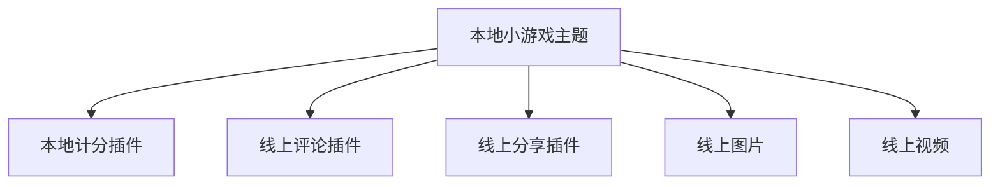
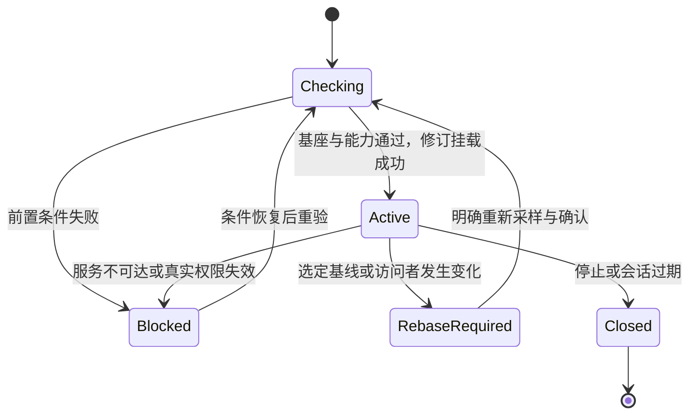

# 全程用 AI 开发：一次具体场景的实走与推演

时间：2026-10-14。不是开发成品，也不是完整预览 PASS。本文用真实 CLI/线上元数据验证能做的步骤，用开发者角色推演尚未实现的步骤；二者分开记录。

**验证对象是未来的两仓改造方案，主要改运行时支持 mock。** 当前 CLI 没有 preview 是实施现状，不是设计失败。下面目标操作以新增运行时提供器和 CLI 开发适配存在为前提；实际取样只用于校准业务对象与约束。

## 1. 开发者只提出这个需求

“帮我做一个小游戏主题，开发一个计分插件，使用平台已有的评论、分享插件，图片作背景、视频作介绍。修改难度、布局、素材时直接预览，不要频繁发行。最后告诉我怎样正式上线。”

这张图是拟开发关系，不是已经保存到平台的依赖声明或节点实际依赖树。计分插件还要单独演练“插件展品”角色。

## 2. 本轮实际做了什么

脚本：[verify-ai-preview-dry-walkthrough.mjs](../../test/verify-ai-preview-dry-walkthrough.mjs)。使用当前构建 CLI `0.5.8`，通过 tools-lib 调用 dev API；请求白名单只允许 GET 与既有测试账号登录。没有创建资源壳、上传、发行、上架、改节点、签约或支付。

| 实际动作 | 结果与证据边界 |
|---|---|
| 从线上 `vite-react-ts@4.0.0` 初始化主题与插件 | 两个工程创建成功；类型分别 RT001/RT002，锚点 dist 已存在，resourceId 未绑定 |
| 未建壳时执行合法 `version attr add` 输入 | 两个工程均拒绝：先 create/bind，再编辑工作稿；不是“属性已经 mock 成功” |
| 尝试 CLI `preview` | 返回 unknown command；`preview --help` 会展示根 help，因此不能以退出码 0 判存在预览能力 |
| 读取已上架主题及依赖 | 读取成功，主题声明了两个已发布插件；未加载代码或验证使用授权 |
| 读取评论插件配置定义 | 有两个 select：布局 vertical/drawer、状态 开启/关闭；默认 vertical/开启 |
| 读取线上图片与视频版本 | 成功确认真实资源 ID、类型、已上架状态与版本；没有读取文件内容 |
| 读取正式节点与主题展品 | 本次三个节点样本中两个暂停运营、一个未设置主题；两个有主题的样本均满足 nodeThemeId 等于返回的 presentableId |
| AI 浏览器打开其中一个正式节点 | 页面显示“筹备中，敬请期待…”；未绕过门禁、未改变节点状态 |
| 主题模板的 npm 依赖锁定解析 | `npm install --package-lock-only --ignore-scripts --no-audit --no-fund` 成功；不是安装全部依赖、启动服务或构建成功 |

模板 package.json 仍含 projectName/version 占位文本。本轮观察到这些文本，但依赖锁定解析成功，所以不能直接宣布“占位文本导致不能安装”。正式启动/构建与模板元数据治理需另测，本轮不改模板实现。

初次采样脚本误用一行式分隔符、版本选项，并在响应采集时覆盖登录 cookie；修正采样器后，合法属性输入准确命中未绑定门禁，节点只读查询成功。它们不是平台或 CLI 新缺陷。

### 实际选择的线上素材

| 用途 | 真实 dev 资源 | 本轮读到的版本 |
|---|---|---|
| 参照宿主 | ZhuC/music-theme，`66b9d54bf6ea12002fd01418` | 1.0.103 |
| 评论插件 | ZhuC/Freelog插件-评论插件，`69dc956b045c7a0030e98b7b` | 1.0.8 |
| 分享插件 | ZhuC/_Freelog插件-主页分享，`69bbb2974ac0ec002fce4ff4` | 最新 1.0.12；参照主题声明 ^1.0.9 |
| 图片 | dj-test/elemental-cat-20261013，`6acdfa48055bff002f6a788a` | 1.0.0 |
| 视频 | dj-test/spicy-potato-video-20261013，`6acdfc46055bff002f6a78e5` | 1.0.1 |

最新版本不等于实际节点解析版本。分享插件未完成该主题范围的节点解析，也没有读其配置定义，不能凭 latest 推定当前挂载版本/可选值。

证据工程：`C:/Users/45534/AppData/Local/Temp/freelog-ai-preview-walk-0uUBQG`；最终只读样本：`C:/Users/45534/AppData/Local/Temp/freelog-ai-preview-walk-W27xyC/read-only-walkthrough.json`。临时文件保留供核查，不进入发行物或 Git；凭据不写入报告。早期工程 `freelog-ai-preview-walk-twOTay` 用于 npm 锁定解析；没有启动本地服务。

## 3. 站在开发者角度，AI 的十个连续检查点

“目标输出”是建议新增产品契约，不是当前 CLI 命令或平台 API 已有响应。

| 步骤 | AI 应接收/执行 | 必须给开发者的输出与下一步 | 本轮状态 |
|---|---|---|---|
| W1 确认基座 | 接收正式节点完整 URL、环境；只读解析节点与主题展品 | 节点可访问性、主题展示版本、浏览器访问者；不可用时不改节点，给换节点/网页处理入口 | 真实节点样本不满足预览前置 |
| W2 初始化两个项目 | 主题与计分插件目录、模板 ID | 独立本地身份、固定类型、产物锚点；列需要启动的工程 | 真实 CLI 通过 |
| W3 开始填写元数据 | “添加作者属性、难度配置” | 新 CLI 写本地开发候选，运行时读取，不要求先建壳；决定发行才接入正式身份/稿。已有正式稿引用同一份数据 | 正式稿门禁已确认；新开发编辑待实现 |
| W4 选择市场素材 | 查询/选择资源，读取真实配置与版本 | 返回 ID、类型、版本候选及声明范围；不把名称当身份，不把元数据可查当有权读文件 | 元数据取样通过 |
| W5 建开发关系 | 主题→计分、评论、分享、图片、视频；指定别名与来源 | CLI 提供关系输入；运行时生成有效图、解析作用域与内容路由，不让两边各拼一套 SDK 响应 | 产品推演，未生成真实预览图 |
| W6 单独看计分插件 | 选择依赖/展品角色，连接本地预览宿主 | 挂载 ID、父链、角色、生命周期、页面入口或具体失败项 | 提供器/预览宿主未实现 |
| W7 进入主题联调 | 两个服务启动、主题主动挂载插件 | 多入口端口不能冲突；实际入口来自服务就绪结果，不假定两项目都用8001 | 未启动服务，待实现/验证 |
| W8 连续改配置/依赖 | 作者定义、节点使用配置、挂载参数分别编辑 | 来源明确、原子修订、迁移差异；浏览器、自身 API 与详情一致 | 产品推演，未运行 mock |
| W9 AI 自检 | 页面观察 + 机器可读诊断 | 分开报告代码运行、mock、真实内容、授权、集成，不只报告“页面打开了” | 只验证了真实节点门禁 |
| W10 准备上线但不发行 | 固定候选、构建及依赖计划 | 上线准备单、未完成项、禁止进入 payload 的数据；不能返回 releaseReady=true | 未构建/发行，仅形成计划模型 |

开发者与 AI 的交流可以很少，但节点可用性、选择 fixture/真实资源、网页签约支付、安全权限和决定发行，都不能靠 AI 默认替人做掉。新应用编辑候选不必先处理网页发行步骤。

## 4. 补齐 AI 的最小输入与输出契约

### 输入：不用开发者填写一堆平台 ID

开发者提供需求、项目位置与正式节点 URL即可开始。AI/CLI 自动读取并校验 nodeId、主题展品 ID、展示版本和资源类型；未确定的业务选择明确询问，不能根据标题、Cookie 或 URL 的 dev 参数推断授权主体。

预览操作的规范化输入应有：

- 节点 URL、平台环境、浏览器连接；不包含登录秘密。
- 组件引用、工程路径、已确认本地服务入口、主题/插件角色与作者数据来源（候选稿或 fixture）。
- 关系的父组件/别名/目标来源：本地组件引用、线上 resourceId+范围、明确本地素材/fixture。
- 当前展示基线、本地展品/nid 配置、挂载参数，分别记录。

CLI 命令名/传输格式仍由跨仓协议决定。这里定义的是产品输入，不把自造 JSON 当平台展品 API 响应。

### 输出：一眼知道哪里能继续

建议诊断分成 ready、blocked、action_required 三种结果，至少包含：

| 字段 | 含义 |
|---|---|
| operation/componentRef/scope | 在哪个操作、组件及链路发生问题 |
| requestedRevision/effectiveRevision | 提交和实际生效的修订；未生效可为空 |
| code/checks | 稳定原因及逐项检查结果，不用白屏表示所有错误 |
| instance | 已挂载时返回会话实例 ID、父实例、角色、关联展品/nid 与渲染名；未挂载不编造成功 ID |
| previewUrl | 真正可打开的配对入口；未就绪不返回假成功 URL，不包含作者凭据 |
| nextActions | 可继续操作、用户处理入口、是否会产生外部写入 |
| evidenceLevel | 实际代码运行、fixture、真实读取、未验证分别标识 |

例如稳定原因可区分：node_unavailable、author_identity_unbound、preview_capability_missing、remote_route_unconfirmed、remote_auth_denied、config_migration_ambiguous、browser_permission_required。它们是**建议的预览控制面原因**，不是替换平台 errCode/authCode；真实响应仍保留。

自检至少分开：本地服务就绪、端口/入口、来源允许、会话配对、证书/浏览器权限、运行时协议、挂载、有效修订和远端访问。AI 没检测到的检查项写 unknown，不能写 PASS。

## 5. 用具体输入验证配置迁移

以下后两列含假设新定义，是反事实 fixture，不是擅自修改他人线上插件。

| 旧定义/配置 | 新候选/关系 | 目标结果 |
|---|---|---|
| 评论布局 vertical/drawer，节点选 drawer | 只改默认为 vertical，候选项不变 | 保留 drawer；作者默认和节点选择不同仍合法 |
| 同上 | fixture 假设候选仅 vertical | 迁移回新默认并报告原因；直接输入 drawer 则拒绝 |
| 本地难度 editableText，已选 hard | 自研插件候选改 select，候选含 hard | 保留 hard；若不含则按默认回退 |
| 节点新增 key=description | 作者候选新增同名 readonlyText | 版本定义生效，报告覆盖来源，不静默混合两份值 |
| 评论位于同一 nid，挂载两次 | 实例参数不同 | 共享节点配置，参数分别隔离；不伪称平台支持实例配置持久化 |
| 插件旧 nid 改变 | 新树有唯一确认映射/有两个可能位置 | 前者迁移并报告；后者阻塞，让 AI 明确位置，不按标题匹配 |
| 作者稿来自新版，节点仍展示旧版 | 切入候选联调 | 显示两份基线；进入纯线上验收仍以节点真实版本为准 |

这些是目标测试向量，不是执行结果。实现投影后要和真实版本切换样本对照。

## 6. 不发行也应有一份上线准备单

准备单固定本次工程/产物摘要、作者稿摘要、解析版本、开发关系图、验证结果和未决条件；失效后需重新确认。它是一次操作快照，不写入 N.json，也不是版本历史库。

本场景的准备单至少给出：

1. 自研计分插件先构建、上传分析、正式发行/所需上架；不含预览宿主。
2. 将计分插件的真实 ID/范围及合法远端依赖写入主题稿，再构建发行主题；不用本地 componentRef、虚拟 nid 或模拟解析结果提交。
3. 评论/分享/图片/视频只是选定样本；实际版本解析、合法访问与上游授权仍是未决项。
4. 节点选择新主题展品或已有主题的新展示版本；迁移/设置真实展品与依赖插件配置；访问者授权另验。
5. 打开无开发参数的新页面纯线上验收。

本轮 releaseReady=false：没有可用预览基座、没有已实现提供器、没有运行/构建/真实内容消费证据。准备单不能替代授权或自动发版，更不能因为写出了拓扑顺序就称发行验证通过。

## 7. 假设新增能力实现，再走运行时的完整闭环

### 7.1 一份输入图，由运行时生成一个有效图

CLI 提供未发行组件、作者来源、关系与场景。运行时接收完整候选，校验、解析并返回有效图；CLI 只展示，不重做投影。快照需要以下规范化字段，具体编码仍在 P1 固定，不等同平台 payload：

| 记录 | 必需的信息 |
|---|---|
| 修订 | sessionRef、requestedRevision、基座 nodeId/展品/展示版本、配置来源摘要与采样时间 |
| 本地组件 | componentRef、主题/插件类型、未发行标记、作者来源引用、已就绪入口与框架/loader |
| 关系输入 | parentRef、edgeRef、别名、目标来源、挂载角色；远端目标另有 resourceId 与 declaredRange |
| 有效关系 | 运行时生成的预览 nid、完整父链、resolvedVersion 或 unpublished、属性来源、loader、routeStatus |
| 实例 | 运行时生成的 instanceRef、parentInstanceRef、有效关系引用、seq、角色和实际入口 |

routeStatus 区分 local、fixture、verified_real、unconfirmed、denied；查到元数据不能生成 verified_real。路由凭据不出现在快照里。一个实例关联一个有效作用域，同一作用域可有多个实例。

固定候选图时，线上新版本不自动替换已解析版本；跟随线上模式发生变化则重新采样、显式重建修订。CLI 本地引用不直接伪装成 resourceId/nid 发给平台。

### 7.2 运行时 SDK 接管矩阵

| API/作用 | 本地组件或 fixture | 远端依赖/真实对象 | 写入与失败边界 |
|---|---|---|---|
| getSelfProperty / ForTheme、挂载 property | 同一修订的作用域投影 | 选定版本+该展品/nid 配置基线 | 保持各方法原有同步性/信封；不能读回无关基座属性 |
| getSelfDep / ForTheme、依赖详情 | 有效图中对应父链 | 固定的真实解析数据，标来源 | 未映射的虚拟 ID 拒绝；不把旧缓存当新修订 |
| 节点/主题视图、展品列表/详情 | 在声明的开发视图内一致加入/替换 | 真实对象仍走正常路由 | 不改真实节点/基座授权，不全局篡改所有响应 |
| 插件入口、文件流、子文件、图片/视频 | 对应 loader 的本地/fixture 内容 | 仅有效真实访问路径 | 授权 fixture 成功不放行真实文件；先路由再构造 URL |
| 展品/单品授权查询及授权 UI | 显式模拟状态，仅作用于模拟对象 | 实际结果及原 authCode/责任方 | 签约/支付默认拒绝；不是“所有接口都返回授权 true” |
| 合集列表、单品、单品依赖 | 只覆盖声明的局部 fixture 范围 | 按真实 exhibitId/itemId/nid 请求 | 未适配报未支持；不伪造空结果 |
| 用户信息与变更 | 场景用户信息需标模拟，不改变浏览器真实用户 | 真实身份依正常 SDK 读取 | 登录状态变化要重新核验，CLI 作者凭据不注入 |
| 评论、分享事件、播放统计、奖励等写路径 | 有显式适配器时写会话沙盒并标结果 | 默认拒绝真实写入 | 不支持适配的调用报未支持，不制造真实回执 |

P1 必须按当前运行时实际导出逐项登记方法、信封与参数，这张表不是声称已有全部适配。缓存按会话、有效修订、节点/展品、父链/nid/itemId、具体调用及参数区分；实例通信另按 instanceRef 隔离，真实授权不因候选固定而永久缓存。

真实远端插件也受预览写入默认拒绝约束。业务代码绕开 SDK 自行请求第三方服务时，提供器不能保证接管；需明确测试适配与网络观测，没有证据的写路径不计通过。沙箱不是执行恶意代码的隔离保证。

### 7.3 外部变化不能静默改变验收结论

节点暂停、主题门禁异常、配对失效：停止对应开发解析，不回落线上画面伪称预览正常。访问者切换：清理用户相关路由与授权缓存，重新核验；不能沿用旧账号的结果。固定模式下远端新版本仅提醒，跟随模式下进入重新采样流程。

非法新修订不覆盖旧生效修订，诊断分别记录二者；旧视图仍合法时可继续，但“最新测试通过”必须为 false。score 本地服务重启要重验入口与挂载，不能仅因端口恢复就称全部实例成功。

上线准备单是另一份冻结快照，不是会话状态。作者数据、产物或解析图摘要变化就失效，releaseReady=false；实际授权还需执行时重验，冻结不固定商业授权。

### 7.4 三个组合向量

1. 本地主题+计分+线上评论：同一评论 nid 两实例、节点选 drawer；固定图保持1.0.8，远端发布新版只提示。切入跟随并采用反事实新 select 仅 vertical 时，两个实例同修订回退 vertical，挂载参数各自保留。
2. 计分插件从依赖切为展品角色：建立独立预览展品作用域，不复用原主题 nid 配置；评论、图片、视频路径分别解析；计分服务断开时只报告受影响实例，不称整场景通过。
3. 本地计分发行后转真实引用：发行前是 componentRef/unpublished，发行后重新构造真实依赖与配置映射；有歧义则阻塞。正式节点仍使用旧主题版本时，退出预览的检查明确失败，不能以候选画面代替上线证明。

这是对新增运行时能力的场景推演；不是本轮真实挂载结果，也不要求先实现游戏逻辑才能验证这些契约。

## 8. 本轮对设计的实际结论

场景实走证实了初始化和未绑定门禁，实际响应补强了主题展品身份、节点/依赖覆盖层、远端真实配置定义的证据。

开发者角色复审发现：原稿对象正确，但尚缺节点输入、纯本地候选、挂载诊断、阻塞恢复、迁移样本、SDK 接管矩阵、有效图、外部变化处理和上线准备产物。本文补为两仓协同产品契约，核心实现归运行时；不将“已补设计”当“已实测通过”，也不将“当前缺实现”当作新增方案不成立。

**结论：本次是“真实前置取样 + AI 操作链推演”，不是主题、插件与线上素材完整浏览器联调。** 后续应按 W1–W10 每步积累证据；未实现或缺外部条件保持阻塞，不能用另一份文档替代真实运行。

补齐运行时矩阵、有效图、变化处理和纯本地候选后，独立开发者角色复审未发现阻断级产品矛盾，认可作为跨仓协议定稿依据；不是允许跳过 P1 的实际 SDK 清单/响应样本核对，也不是功能 PASS。
